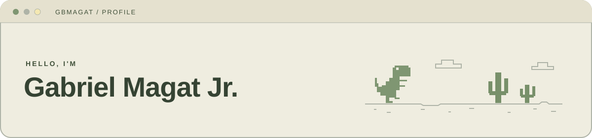
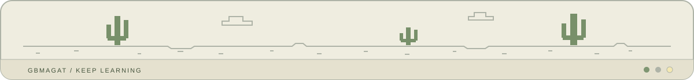

  <strong>Computer Science student · Full-stack development · Cloud computing</strong> 
  Holy Angel University &nbsp;|&nbsp; Philippines

  
  

---

### About me

I'm a fourth-year **BS Computer Science student** building web applications through freelance work and academic projects. I enjoy connecting the pieces—from a responsive interface and backend API to a database and a running application on a Linux server.

- 💻 **Building web applications:** responsive interfaces, backend APIs, and dashboards with React, Next.js, Node.js, and Express.
- 🗄️ **Working with data:** MySQL, PostgreSQL, and SQLite for application records, participant tracking, and reporting.
- 🚀 **Deploying projects:** Linux servers, SSH, Nginx, domain configuration, and HTTPS.
- 🧪 **Checking user flows:** Playwright-based checks for desktop and mobile web experiences.
- 🔎 **Applying computer science:** exploring skill matching and shortest-path algorithms through my JobFinder thesis project.
- ☁️ **Learning cloud computing:** completed AWS Academy Cloud Foundations training and used Amazon EC2 and AWS Lambda in coursework.
- 🎵 **Beyond coding:** served as a student-organization secretary and manage social media for the Holy Angel String Ensemble.

### Tech stack & tools

Technologies I have used in freelance work, academic projects, and coursework.

#### Languages

  
  
  
  
  
  

#### Frontend

  
  
  
  
  

#### Backend & databases

  
  
  
  
  

#### Cloud & deployment

  
  
  
  
  
  
  
  
  

#### Development & testing

  
  
  
  

### Cloud journey

I'm working toward a career in **cloud computing**, with an interest in infrastructure and application deployment. I completed **AWS Academy Cloud Foundations** training and used **Amazon EC2** and **AWS Lambda** in coursework. I'm building on that foundation through web application and Linux server projects.

---

  

